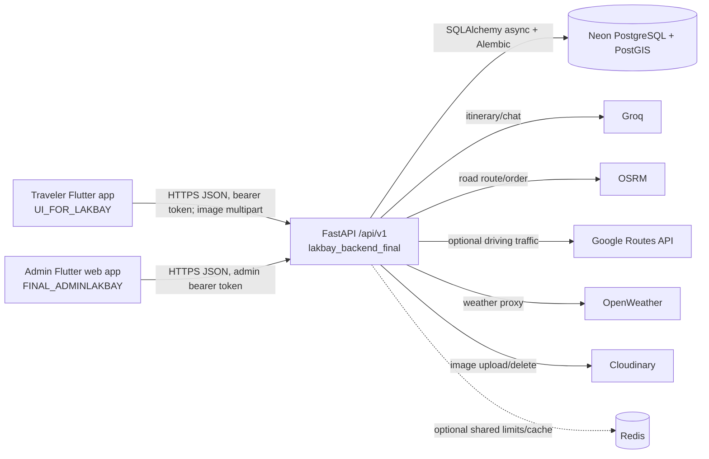

# Lakbay+ system context and Claude Code handoff

**Approved scope update — 10 November 2026:** the current version uses saved
place pins for Top 5, AI itinerary context and approximate route planning.
Visitor-arrival verification and its admin editor are deferred. Keep optional
arrival fields and their validation; no schema change is approved or needed.
Admin review still covers place identity, pin location, access, prices and hours.
This supersedes arrival-verification priorities in the historical snapshot below.
Read the [current audit and handoff](docs/claude_codex_objectives_audit_2026-11-10.md)
and [updated objectives plan](docs/objectives_panel_upgrade_plan_2026-11-09.md)
for current work status and the locally tested per-person budget correction.

**Implemented locally — 10 November:** saved travel details now reach the
traveler's existing tips section, and itinerary prompts retain place pins,
access/travel notes and rate currencies/charging units. Admin save and refresh
regressions passed (58 focused backend, 204 traveler, 38 admin tests; both apps
analyze clean). See [the API guide](docs/ai_itineraries.md). No schema change,
live-data edit, deployment or phone verification was performed for this slice.

**Snapshot date:** 6 November 2026 (Asia/Manila). **Primary checkout:** `lakbay_backend_final`, branch `main` at `ddf304d`, with substantial modified and untracked work. This document describes the files currently present, including that local work; it is not a claim that every local change is deployed. The traveler and admin applications are separate sibling repositories (`UI_FOR_LAKBAY` and `FINAL_ADMINLAKBAY`) and are **not included** when only this backend repository is handed over. Their details below come from read-only inspection of those sibling folders and dated project notes.

## 1. Executive summary and core objectives

Lakbay+ plans trips in the Davao Region from a curated destination catalog. Travelers can discover places, receive explainable preference recommendations, preview routes and costs, generate AI itinerary drafts, save trips, collaborate, record expenses and memories, and export reports. Geoanalytics means scoring *which places fit together* by distance, route time, district, preferences, and cost, rather than displaying pins alone. Administrators curate the catalog and rates and review unpublished OpenStreetMap (OSM) candidates before publication.

**Current phase.** The phase plan in [docs/core_focus.md](docs/core_focus.md) records backend increments through Phases 0–14 and Phase 15B–15F. The active work is Phase 2 catalog quality/visitor arrival verification, Phase 14 operational hardening, and incremental Phase 15 planning. A dated Step 0 audit reports that the candidate queue, admin Place review page, and walking-profile guard were released; its deployment and database numbers are historical observations, not a fresh check for this handoff ([docs/archive/step0_readiness_audit_2026-11-05.md](docs/archive/step0_readiness_audit_2026-11-05.md)). The 4 November multi-day/live-replanning document is a **proposal**, not an implemented capability ([docs/multiday_live_trip_proposal_2026-11-04.md](docs/multiday_live_trip_proposal_2026-11-04.md)).

**Measured milestone, with limits.** The Step 0 audit observed 30 active public destinations, zero with `route_ready=true`, 648 staged candidates and zero published candidates in Neon after its release. Recheck those counts before relying on them. The same audit records 421 backend tests on the isolated walking-guard release and 60 traveler Flutter tests for later *local, unpushed* route-card edits. Those counts do not certify the present dirty checkout. Current local provider-usage documentation records additional work and tests ([docs/archive/provider_usage_review_2026-11-03.md](docs/archive/provider_usage_review_2026-11-03.md)).

## 2. Architecture and interconnections

- The API is Python/FastAPI, not Node or Go. [app/main.py](app/main.py) creates the app, CORS and exception handlers; [app/api.py](app/api.py) registers feature routers under configurable `/api/v1`. Routers parse requests; services implement behavior; repositories use an async SQLAlchemy session ([app/db/session.py](app/db/session.py)). `GET /api/v1/health` reports environment and timezone but currently has no build SHA. OpenAPI is at `/docs` and `/openapi.json` when the server runs.
- Only the backend holds `DATABASE_URL` and provider secrets. The clients share server contracts and identifiers, **not** a database connection or a shared Dart/Python model package. Contract changes therefore require coordinated DTO updates and integration tests in both Flutter repositories. Server responses use snake_case IDs such as `destination_id`; the traveler API mapper converts them into Dart models.
- Authentication is JSON register/login/refresh/logout. Passwords use PBKDF2-SHA256; access tokens are signed HS256 JWTs (default 30 minutes). Refresh tokens are random, hashed in `refresh_tokens`, rotated and revocable (default seven days). `get_current_user` checks an active user; `require_admin` checks `role == admin` ([app/core/security.py](app/core/security.py), [app/core/dependencies.py](app/core/dependencies.py)). Trip-owned endpoints apply owner/member checks in their services. Public admin registration requires `ADMIN_REGISTRATION_CODE`; protect this deployment setting.
- Dynamic planning payloads use Pydantic models and `planning_state` plus `input_revision`. `POST /planning/preview` recalculates a stateless canonical state, choices, cost lines, missing information and optional route; planning-aware `/ai/chat` returns validated partial `state_updates` and a new preview. The client should ignore stale revisions, retain returned state and clear generated options after meaningful plan changes ([docs/planning_preview.md](docs/planning_preview.md), [docs/ai_itineraries.md](docs/ai_itineraries.md)). A generation request with planning state must match selected IDs, counts and budget. `POST /trips/from-ai-option` takes the selected generation-run ID and option number; the server reloads its validated stored option, rather than trusting replacement client text.

### Persistent model map

Models live under `app/features/*/models.py`; [app/db/base.py](app/db/base.py) imports them for Alembic. Key tables are:

| Domain | Tables and relationship |
| --- | --- |
| Identity | `users`, `refresh_tokens`; one user has refresh tokens and owns saved data. |
| Catalog | `destinations` (coordinates, PostGIS `geography(Point,4326)`, verified arrival metadata, fees, accessibility and active flag), `accommodations`, `transportations` (rates attached by `destination_id`), `destination_candidates` (OSM review queue, linked to a destination only after explicit publication). |
| Recommendations | `user_preference_signals`, `destination_interactions`, `destination_popularity`. |
| AI | `ai_generation_runs` stores purpose, model ID/role, prompt version, latency, tokens, validation/fallback status and JSON input/output summaries. |
| Trips and collaboration | `trips`, `trip_destinations`, `trip_itinerary_days`, `trip_itinerary_activities`, `trip_routes`, `trip_members`, `trip_tasks`. A saved route is a snapshot, including stops/legs and optional geometry. |
| Post-trip | `trip_expenses`, `trip_expense_splits`, `trip_memories`, `trip_reviews`, `notifications`. Reports and planning previews are generated on demand without dedicated tables. |

The current Alembic chain ends at local revision `2026_11_04_0800` (`destination_candidates`), after `95bb71db451f` (nullable unknown destination estimates). **Do not infer that a database is at this head**; run `alembic heads` and `alembic current` against the intended environment. [docs/client_integration.md](docs/client_integration.md) still names an older migration head, so prefer the migration files and live check. PostGIS is created in the early catalog migration; do not model PostGIS system objects. See [docs/migrations.md](docs/migrations.md) for the workflow.

## 3. Component status and objectives

### A. Traveler mobile app — Flutter/Dart

**Location and stack.** Separate sibling repo `UI_FOR_LAKBAY`. Its `pubspec.yaml` requires Dart `^3.10.0`; an exact installed Flutter version was not established here. It uses `provider` with `ChangeNotifier` (`AuthProvider`, `TripProvider`, theme/navigation/language providers), `flutter_map` + `latlong2` for maps, `geolocator` for device location, `http` for API calls, `flutter_secure_storage` for session tokens/bookmark IDs/profile-photo metadata, and `image_picker`/`path_provider` for media workflow. There is no declared Hive/Isar/sqflite dependency. Provider state and some trip/draft lists are in memory; do **not** treat the profile screen's “local database/offline maps” copy as proof of durable offline trip or tile storage.

**Implemented UI and integration.** Screens cover auth, catalog/districts/details, home search, planner and conversational planner, itinerary results, trips, group dashboard/tasks, memories, notifications and profile. `lib/services/api_service.dart` calls the backend for catalog pages, recommendations/grouping, planning preview/feedback, AI chat/generation, saved trips, group members/tasks/expenses, memory upload, PDF and weather. The live catalog paginates and shows an error/retry state rather than silently replacing failed results with sample places ([docs/client_integration.md](docs/client_integration.md)). Map widgets appear in destination detail, planner results and group dashboard. The route result can carry a `polyline5`, `route_provider`, `is_estimated`, `coordinate_basis` and warnings; estimated geometry must never be promoted into verified navigation.

**Recent status and caution.** Dated Step 0 notes report local detail-screen Drive/Walk selection, clearer distance labels and a 60-second request timeout; those traveler edits were not pushed at that point. A signed-in live walking calculation and exact prior route failure were still unresolved. Inspect that sibling repo's current worktree and device behavior before declaring the issue fixed. Its `GeminiService` class calls `ApiService.generateAIItinerary`, which calls this backend; it does **not** call a Gemini SDK. Some UI/privacy/notification strings still say “Gemini” and overstate local offline persistence. The default API URL in the inspected client is the Render backend and can be overridden with `--dart-define=API_BASE_URL=...`; verify build flavor and URL before local tests.

**Next work.** Verify local versus committed traveler changes; run `flutter analyze`/tests in its own repo; test authenticated Drive and Walk results, timeout/error display, null polyline and arrival-point warnings on a device; audit client copy about Gemini/offline data; add only explicitly scoped offline caching or more screens after a phase review. The proposed shared Home/Planner draft, multi-day schedule and live detour workflow must be reconciled with actual current client state before implementation.

### B. Backend services and infrastructure

**Current capabilities and route inventory.** The feature folders in `app/features/` implement these currently registered API families (all prefixed `/api/v1`):

| Family | Main endpoints / purpose |
| --- | --- |
| Health/auth/users | `GET /health`; `POST /auth/register`, `/auth/register/admin`, `/auth/login`, `/auth/refresh`, `/auth/logout`; `GET/PATCH /users/me`. |
| Catalog/admin | `GET/POST /destinations`, `GET/PATCH/DELETE /destinations/{id}`; destination-scoped accommodation/transportation GET/POST with per-rate PATCH/DELETE; admin-only `POST/GET /admin/destination-candidates`, `GET/PATCH /admin/destination-candidates/{id}`, `POST .../{id}/reject`, `POST .../{id}/publish`. Catalog/rate delete is soft deactivation. |
| Discovery | `POST /recommendations`; latest preference and interaction/popularity routes; `POST /geo-analytics/destination-groups`. Grouping is stateless and uses scored, route-checked groups. |
| Planning/AI | `POST /budgets/estimate`, `/planning/preview`, `/planning/feedback`, `/ai/chat`, `/ai/itineraries/generate`. Preview and feedback are stateless; generation attempts are audited. |
| Routing/weather | `POST /routes/preview`, `/routes/optimize`; `GET /weather/current`, `/weather/forecast`, `/destinations/{id}/weather`. |
| Trips/post-trip | `POST/GET/PATCH/DELETE /trips...`, `/trips/from-ai-option`, archive, saved route, members/tasks, expenses/summary, memories/upload, reports/summary and PDF, reviews/summary, notifications/read state. |
| Evaluation | Admin-only `GET /evaluation/summary?window_days=30` aggregates AI attempts, catalog engagement and arrival readiness; it does not claim recommendation accuracy from unattributed catalog interactions. |

Exact methods, path parameters and response schemas are authoritative in each `router.py` and generated OpenAPI. The [README](README.md) endpoint list is selective; avoid treating it as exhaustive. The feature-based structure, async sessions and Pydantic validation are deliberate. CORS is configurable; `.env.example` permits `*` for local development, and production/browser origins should be explicit. App timezone is `Asia/Manila` ([app/core/config.py](app/core/config.py)).

**Route optimization: exact current algorithm.** The request takes 1–10 destination IDs by default (configurable to at most 25), `travel_mode` (`driving`, `walking`, `public_transport`), optional origin, `return_to_origin`, optional `use_live_traffic`; optimize additionally takes `preserve_first_destination`. `return_to_origin=true` requires an origin. Duplicate IDs, absent/inactive destinations and invalid coordinates are rejected. Each stop uses verified `arrival_lat/lng` only when `route_ready`, source URL and verification timestamp are all present; otherwise it uses attraction `lat/lng` with a warning. Coordinates are sent to OSRM as `longitude,latitude`.

1. **Preview** preserves input order. Driving uses OSRM `GET /route/v1/{profile}/{coordinates}` with simplified encoded polyline and steps. Walking uses a separately configured `OSRM_WALKING_BASE_URL`; setting the same driving host or changing only the URL profile is not proof of a foot graph. Preview accepts provider waypoints only if each snap distance is at most **250 m**. Public transport never calls OSRM and is labeled `stored_transportation_estimate`.
2. **Optimize** asks OSRM `GET /trip/v1/{profile}/{coordinates}` for a suggested waypoint order. The client validates the returned permutation and leg count. `roundtrip` follows the request; an open OSRM Trip is constrained to fixed first/last endpoints, so this is a heuristic suggestion, **not** a guaranteed exact TSP optimum. With an explicit origin, the origin stays first. Optional return appends the first stop.
3. **Fallback** when OSRM is absent/invalid: Haversine distance with Earth radius **6,371 km**, `d = 2R asin(sqrt(sin²(Δφ/2) + cos φ1 cos φ2 sin²(Δλ/2)))`. Optimization uses nearest neighbor from the preserved first stop, or tries every start and picks the shortest Haversine chain when the first is not preserved. Per-leg minutes are rounded from `distance_km / speed_kmh × 60`, with fixed speeds of **40 driving, 5 walking, 30 public transport km/h**. Fallback responses are `is_estimated=true`, without road polyline or turn directions.
4. **Optional live traffic** applies only to driving when `use_live_traffic=true` and Google Routes is configured. It calculates a fixed-order live ETA/traffic summary; for optimization, OSRM still chooses the order, then Google Routes estimates that order. Failure falls back to OSRM/Haversine with a warning. Planning preview explicitly sets `use_live_traffic=false`; it adds route/fuel estimates only for complete, unambiguous road choices and blocks a road route for detected boat/air access hints.

These routes optimize **stop order and travel duration only**. There is no implemented opening-hours time-window solver, day-by-day scheduler, periodic GPS ingestion or automatic detour recalculation. Current destination hours and travel notes are mostly free text. A traveler can submit a new preview request with changed origin/IDs, but that is not a saved, accepted live-plan revision. No OSRM Table matrix or 2-opt pass is implemented ([app/features/routes/service.py](app/features/routes/service.py), [app/integrations/osrm/client.py](app/integrations/osrm/client.py), [app/features/planning/routing.py](app/features/planning/routing.py), [docs/routing.md](docs/routing.md)). Route results include ordered stops/legs, distance/duration, provider, estimate flag, optional polyline/traffic and warnings. Direction steps are suppressed unless all destination arrival points are verified.

**AI provider, prompt and migration position.** Groq is the implemented model provider through an `httpx` OpenAI-compatible chat-completions client, with model IDs and limits in environment variables. There is **no backend Gemini API integration or migration underway**. `GROQ_MODEL_DEFAULT/FAST/QUALITY/FALLBACK` select roles; optional compare slots A–C support research runs. The itinerary prompt includes catalog IDs, selected rates, budget, traveler counts, style and requirements; planning-enabled generation adds canonical preview cost provenance, origin-inclusive route and warnings, top preference matches within selected IDs and scored groups. Chat uses live catalog retrieval with a local hashed-vector RAG ranker, then validates any planning-state patch. Itinerary calls request a strict JSON schema; backend validation checks minimum option count, exact day sequence, selected/allowed IDs, cost arithmetic and budget. Failed/invalid attempts can try a distinct configured fallback; model comparison attempts are recorded separately. Each attempt writes an `ai_generation_runs` audit record. A selected valid run can later be saved through `/trips/from-ai-option` ([app/features/ai/service.py](app/features/ai/service.py), [app/features/ai/validators.py](app/features/ai/validators.py), [app/integrations/groq/prompts.py](app/integrations/groq/prompts.py), [docs/ai_itineraries.md](docs/ai_itineraries.md)).

If Gemini is proposed later, treat it as a **new feature/provider change**: review phase fit, define provider-neutral request/response and schema validation, map model IDs and quotas to environment settings, persist provider/model/prompt provenance, compare on the same catalog snapshot and evaluation criteria, test rate limits/fallback behavior, then approve rollout and client-copy changes. Do not claim a Gemini deprecation path, SDK, prompt format or performance baseline exists today. Existing Groq comparison artifacts are under `outputs/groq-*`; they are dated experiment outputs, not general proof that one provider is superior.

**Other integrations and operations.** PostgreSQL on Neon with GeoAlchemy2/PostGIS is the intended database. The ORM has a GiST index for destination geography, but current grouping logic is service-side candidate enumeration/scoring and route calls, not a measured high-throughput spatial-query service. OpenWeather is proxied/cached, Cloudinary stores uploaded trip images, ReportLab builds PDFs, Google Routes is optional traffic and Redis is optional shared provider usage/cache backing. When Redis is absent, provider guards/cache are process-local; if configured but unavailable, usage-protected calls fail closed with 503. Per-user AI, per-model Groq, weather and upload limits are in [app/core/config.py](app/core/config.py); see [docs/provider_usage.md](docs/provider_usage.md) before changing cost controls. The default OSRM host in `.env.example` is a public development/demo endpoint. Provider keys and DB URLs belong in `.env` or deployment secrets, never source.

**Next backend work.** First reconcile this dirty checkout with the deployed mainline; inspect `git diff` before selecting changes. Recheck Alembic head against target Neon, active/route-ready/candidate counts, and deployed build identity. Run tests locally with mocked providers; use controlled authenticated live checks for walking, OSRM snaps, weather and Groq separately. Prioritize visitor arrival verification and admin catalog quality. For multi-day scheduling or live detours, implement the proposal as separately approved increments with structured hours, arrival/access facts, per-day constraints, acceptance/revision contracts and tests. Add observability/build SHA and measure expensive grouping/routing paths before claiming throughput. Keep schema edits in approved Alembic revisions.

### C. Admin dashboard — Flutter web

**Location and stack.** Separate sibling repo `FINAL_ADMINLAKBAY`. It is a Flutter web app, not a React/Next.js dashboard. `pubspec.yaml` requires Dart `^3.11.5` and declares `http`, `shared_preferences`, `google_fonts`, `flutter_map` and `latlong2`; no Leaflet, Mapbox or Chart.js dependency was found. The inspected `lib/` had no `FlutterMap` widget use, so do not claim a live heatmap or analytics map. Theme preference/session data use `shared_preferences`; `lib/services/api_service.dart` calls backend JSON endpoints, refreshes tokens and takes `API_BASE_URL` from `--dart-define` (default inspected URL: Render backend). A local Edge run and successful web build are recorded in the dated Step 0 audit; public hosting is not established there.

**Implemented screens.** Login/session gate; overview with active-destination count; destination catalog/editor; accommodation and transportation rate editor; and **Place review** with staged/published/rejected candidate pages, source evidence and explicit Save/Publish/Reject. Admin API calls cover own profile, destinations, rates and candidate review. The backend enforces `require_admin` on mutations/queue and evaluation, so browser navigation alone is not the security boundary. Candidate publication creates a public destination only after district/category/visitor purpose, access source/time and duplicate checks; published destinations still default `route_ready=false` until their arrival point is separately verified ([app/features/destinations/candidate_service.py](app/features/destinations/candidate_service.py)).

**Limits and next work.** The User Accounts page currently shows the administrator's own profile and says no traveler directory exists. Reviews and Trip Information are explicit capability placeholder screens because backend trip/review access is owner/member scoped. The admin UI does not currently use the available `/evaluation/summary` endpoint. There is no verified heatmap, recommendation-quality audit UI, global user moderation/export flow or RBAC role matrix beyond `user`/`admin`. Add any global admin data endpoints only after a privacy/authorization scope review; then build corresponding dashboard screens and server-side pagination/filters. For near-term catalog work, improve candidate evidence validation and arrival verification and expose route readiness clearly. Treat analytics heatmaps/exports as proposed features, not current behavior.

## 4. Concrete handoff sequence for Claude Code

1. **Identify all checkouts and preserve local work.** Read [AGENTS.md](AGENTS.md), [docs/core_focus.md](docs/core_focus.md), [docs/new_feature.md](docs/new_feature.md), this file and `git status/diff`. This backend working tree had many modified/untracked files when this snapshot was written. Inspect `UI_FOR_LAKBAY` and `FINAL_ADMINLAKBAY` separately if they are provided; do not assume they accompany a backend-only archive. Never reset, overwrite or bulk-commit user work.
2. **Establish environment and truth.** Use Python `venv`/`pip install -r requirements-dev.txt`; copy `.env.example` to a private `.env` and supply Neon/JWT/admin secrets and only the provider keys needed. `alembic heads`, `alembic current`, then an approved/reviewed `alembic upgrade head` if needed. Run `uvicorn app.main:app --reload`; inspect `/api/v1/health` and `/openapi.json`. The old migration head in `docs/client_integration.md` is stale. Review actual Render deployment and database state independently of dated notes.
3. **Validate current code.** Run `python -m pytest -q` (providers mocked in normal tests), plus focused route, candidate, planning, AI and provider-guard tests for touched code. Check `git diff --check`. Run `flutter analyze` and `flutter test` in each supplied Flutter repo. Do authenticated end-to-end checks for route provider/estimated labels, candidate admin authorization and publication isolation, planning revision handling and saving a validated AI option. Do not use live provider calls in routine tests.
4. **Continue the current phase.** Prioritize verified visitor arrival points and source evidence for the 30 public destinations, candidate review quality, walking-profile/live-route proof, cost provenance and honest UI labels. Route-ready counts, access status and deployment revision need fresh measurements. Keep the current public catalog separate from staged OSM candidates.
5. **Review proposed changes before coding.** For new features, compare [docs/core_focus.md](docs/core_focus.md) and [docs/new_feature.md](docs/new_feature.md). The local project rule requires user permission before code edits, and separately requires explanation and approval for changes to existing tables/columns/relationships/model names. Documentation requested directly can be updated. Any accepted schema change uses Alembic and migration review. Split the multi-day/live-adjustment proposal into small reviewed increments; define API contracts and client behavior together.

### Known debt and verification traps

- **Documentation drift:** [docs/routing.md](docs/routing.md), [docs/ai_itineraries.md](docs/ai_itineraries.md) and [docs/client_integration.md](docs/client_integration.md) retain older phase/deferred or migration-head statements. Use live code/migrations/OpenAPI for current behavior; update old guides when a scoped docs pass is approved.
- **Arrival and access gaps:** Dated Neon observation had zero verified arrival points. Attraction pins, free-text hours, estimated costs and `is_available` rate flags do not prove safe entrance, live opening, booking, ferry service or actual fares. Road geometry to an attraction pin is only a planning line.
- **Routing constraints:** No actual walking graph is configured by `.env.example`; walking falls back to Haversine until a distinct foot-profile service is provided. OSRM demo usage and 250 m snap acceptance are planning safeguards, not production guarantees. Public transport is an estimate; air/sea/mixed routing and time windows are unimplemented.
- **AI and cost accuracy:** Groq prompts are grounded but drafts can still contain unverified hours/fares; the backend validates structure and selected IDs. AI-generated activity estimates are not catalog prices. Unknown destination or child costs keep previews partial. Comparison results require controlled evaluation; no Gemini backend exists.
- **Offline and admin claims:** The traveler app has secure token/bookmark storage but no verified durable offline trip database/map tile cache. The admin app is Flutter web with catalog management, not a deployed heatmap/quality-audit console. UI copy and screen names can overstate these capabilities.
- **Deployment identity and scale:** Health has no commit SHA, so a 200 response cannot identify deployed code. In-memory grouping/planning limiters and optional Redis-backed provider limits need architecture review for multiple workers; no load benchmark was found in this handoff. The present worktree is dirty and may differ from Render `main`.

## Reference map

Start with [README.md](README.md), [docs/core_focus.md](docs/core_focus.md), [docs/client_integration.md](docs/client_integration.md), [docs/migrations.md](docs/migrations.md), [docs/destinations.md](docs/destinations.md), [docs/recommendations.md](docs/recommendations.md), [docs/planning_preview.md](docs/planning_preview.md), [docs/routing.md](docs/routing.md), [docs/geo_analytics.md](docs/geo_analytics.md), [docs/ai_itineraries.md](docs/ai_itineraries.md), [docs/provider_usage.md](docs/provider_usage.md), and [docs/archive/step0_readiness_audit_2026-11-05.md](docs/archive/step0_readiness_audit_2026-11-05.md). The implementation entry points are [app/api.py](app/api.py), [app/core/config.py](app/core/config.py), [app/db/base.py](app/db/base.py), `app/features/*/{router,schemas,service,repository,models}.py`, `app/integrations/`, `app/db/migrations/versions/`, and `tests/`.
